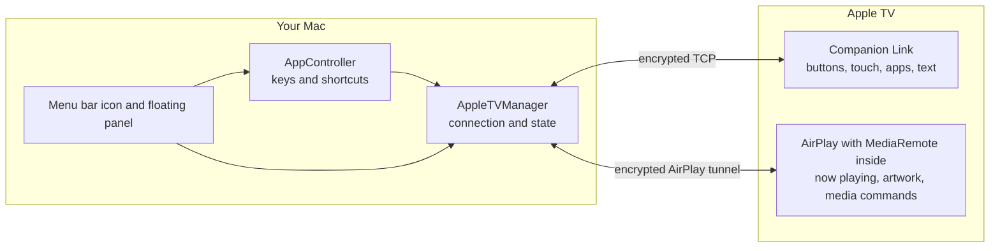
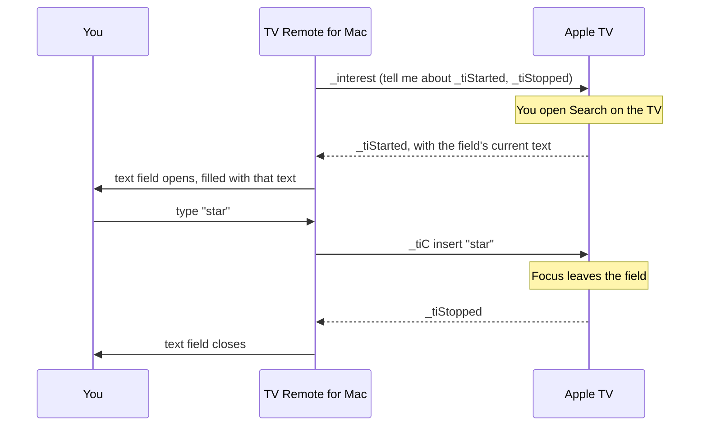

# TV Remote for Mac

**An Apple TV remote in your Mac's menu bar.** Arrow keys move, Return selects, Esc goes back. When the Apple TV asks for text, a text field opens on the Mac by itself, so you just type.

[Русская версия](README.ru.md)


[](LICENSE)


- Talks to the Apple TV directly over your home network, the same way the iPhone remote does. No cloud, no account, no subscription.
- Free and open source.
- Built on [Itsytv](https://github.com/nickustinov/itsytv-macos) by Nick Ustinov. [What's different](#how-it-differs-from-itsytv).

**Contents:** [What it does](#what-it-does) · [Differences from Itsytv](#how-it-differs-from-itsytv) · [Install](#install) · [First connection](#first-connection) · [Keys](#keyboard-shortcuts) · [Scripting](#scripting) · [How it works](#how-it-works) · [Troubleshooting](#troubleshooting) · [License](#license)

## What it does

**Remote**
- A floating remote panel from the menu bar: d-pad, Select, Back, TV/Home, Play/Pause, volume.
- Full keyboard control: arrows, Return, Esc, Delete, Space. Holding a key works like holding a Siri Remote button.
- Shortcut hints on the buttons, and a Keyboard Shortcuts window where you can try every key and change it.

**Typing**
- The text field opens by itself when a text field on the Apple TV gets focus (search, logins, YouTube, Netflix…) and closes when it loses focus.
- Text already typed on the TV shows up on the Mac. Delete works letter by letter.
- ↑ and ↓ leave the field and go straight to the TV.
- Any input language your Mac has, including Russian, Japanese and Korean.

**Everything else**
- Now playing: artwork, title, progress, playback controls.
- App launcher with every app on the Apple TV, drag to reorder.
- Several Apple TVs, with a global hotkey for each.
- Launch at login, AppleScript and a Shortcuts action.

## How it differs from Itsytv

[Itsytv](https://github.com/nickustinov/itsytv-macos) is the original app this project grew from. It's sold on the Mac App Store and is also free on GitHub. This project goes its own way:

| | Itsytv | TV Remote for Mac |
|---|---|---|
| Keyboard on the Mac when the TV asks for text | open it yourself with ⌘K | **opens by itself** |
| Text already typed on the TV | not shown | **shown, editable** |
| Leaving the text field | ⌘K again | **↑ / ↓, or it closes with the TV's field** |
| Connection after the link drops | can loop or lose key presses | **reconnects with backoff, keys wait for the link** |
| Remote left open on another desktop | stays there | **comes to the current desktop** |
| Finding the app in Spotlight | "itsytv" | **"remote", "apple tv", "пульт"** |
| Build | two repositories side by side | **one repository** |
| Promo for other apps in the menu | yes | **no** |
| Shortcut hints, shortcuts window, custom keys, real key holds | yes, since 1.8 | yes (they started here) |

## Install

There's no signed download yet, so you build it yourself. It takes a few minutes.

**You need:** macOS 14 or later, Xcode 16 or later, and an Apple TV (4th generation or later, tvOS 15+) on the same network.

```bash
brew install xcodegen
git clone https://github.com/Lemelson/tv-remote-for-mac.git
cd tv-remote-for-mac
DEVELOPMENT_TEAM=<your Apple team ID> scripts/install.sh
```

The script builds a Release copy, installs it as **TV Remote for Mac – Пульт Apple TV** in /Applications and starts it. The Russian words in the name are on purpose: Spotlight then finds the app by "пульт" too. Your team ID is in Xcode → Settings → Accounts.

Prefer Xcode? Run `xcodegen generate`, open `itsytv.xcodeproj`, pick your team under Signing & Capabilities and run the **itsytv** scheme. (The project and scheme keep the original name.)

## First connection

1. Click the TV icon in the menu bar and pick your Apple TV.
2. The TV shows a four-digit code. Type it on the Mac.
3. Done. The pairing keys are stored in the macOS Keychain, and every later connection is verified with them and encrypted. You won't see the code again unless you unpair, or the Apple TV is reset or replaced.

On the Apple TV the Mac shows up as "TV Remote for Mac".

## Keyboard shortcuts

| Key | Apple TV |
|---|---|
| ← ↑ → ↓ | move |
| Return | select (hold: context menu) |
| Esc | back (hold: Home screen) |
| Delete | TV / Home (hold: Control Center) |
| Space | play / pause |
| = / − | volume up / down |
| ⇧⌘M | mute |
| ⌘K | type on the Apple TV |
| ⌘F | search apps |
| ⌘W | close the remote |

Change any of them in the remote's ⋯ menu → Keyboard shortcuts…

## Scripting

```bash
osascript -e 'tell application id "com.lemelson.tvremote" to pause'
osascript -e 'tell application id "com.lemelson.tvremote" to play'
```

There's also a Shortcuts action that opens the remote for a given Apple TV, handy on a Stream Deck.

## How it works

The app speaks the same two local protocols as the iPhone's remote. Nothing leaves your network.



- **Companion Link** carries buttons, swipes, the app list and text input. The Mac finds it over Bonjour.
- **MediaRemote over an AirPlay tunnel** carries what's playing, artwork, progress, track skipping and mute.
- **Pairing happens once.** The PIN feeds an SRP exchange that leaves both sides with long-term keys. After that each connection proves itself with those keys, agrees on fresh session keys and encrypts every message (ChaCha20-Poly1305).

**Why the keyboard opens by itself.** On connect, the app asks the Apple TV to report text fields. From then on the TV pushes an event each time one gets focus, and that event already contains the text in the field:



More diagrams (pairing, reconnects, key holds, every message the app sends) are in **[How it works, in detail](docs/how-it-works.md)**.

Where the code lives: the protocol layer is the Swift package [`ItsytvCore/`](ItsytvCore) (from Itsytv), the menu bar app is in [`itsytv/`](itsytv).

## Troubleshooting

**No code on the TV when pairing.** On the Apple TV, open Settings → AirPlay and Apple Home and set Allow access to "Anyone on the same network". Turn Require Password off while pairing. In Settings → General → Restrictions, allow AirPlay Settings and Remote App Pairing.

**The remote closes a few seconds after connecting.** Same setting: Allow access must be "Anyone on the same network", not "Only people sharing this home".

**No icon in the menu bar.** On MacBooks with a notch, macOS hides icons that don't fit. Hold ⌘ and drag other icons out of the menu bar.

**Volume doesn't change.** The Mac can only change volume when the Apple TV controls it over HDMI-CEC (Settings → Remotes and Devices → Volume Control). Infrared volume works only from the physical remote.

## License

- The project as a whole, and every change made here, is licensed under **[GPL-3.0](LICENSE)**.
- Code that comes from Itsytv stays under its original **[MIT license](LICENSE-MIT)**, © 2026 Nick Ustinov.

## Thanks

- [Itsytv](https://github.com/nickustinov/itsytv-macos) by Nick Ustinov, the app this one is built on.
- [pyatv](https://github.com/postlund/pyatv), the Python library that documented most of the Apple TV protocols.

Apple TV and macOS are trademarks of Apple Inc. This project is not affiliated with Apple.
