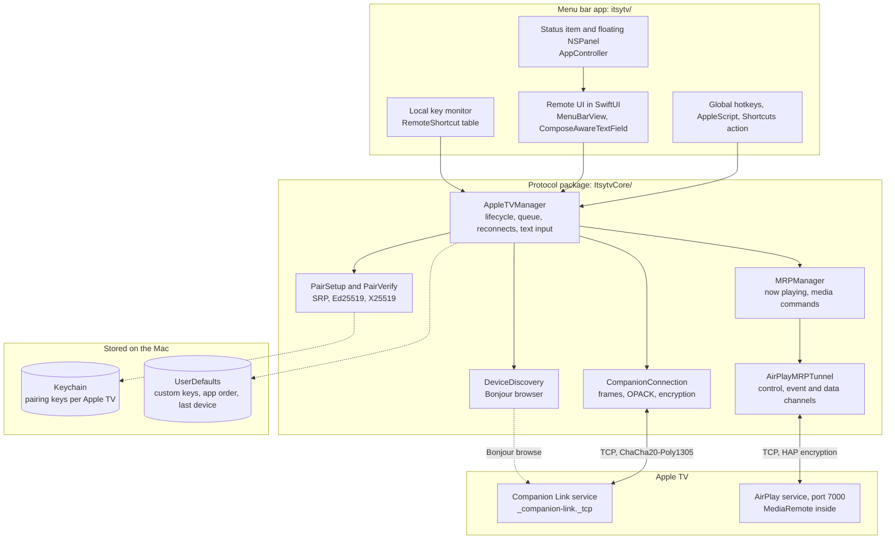
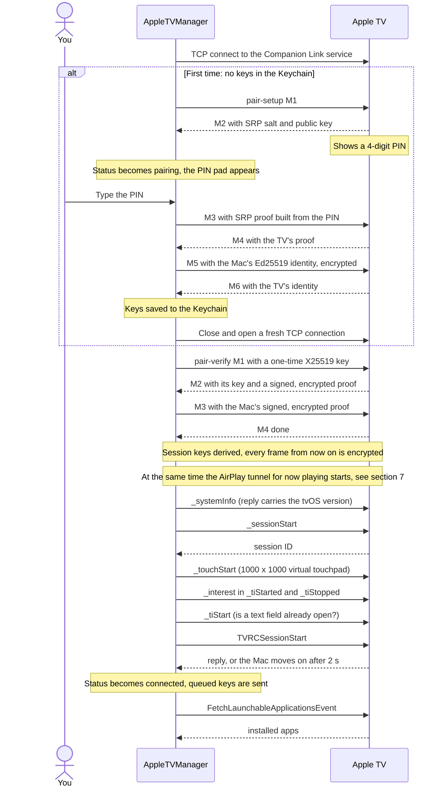
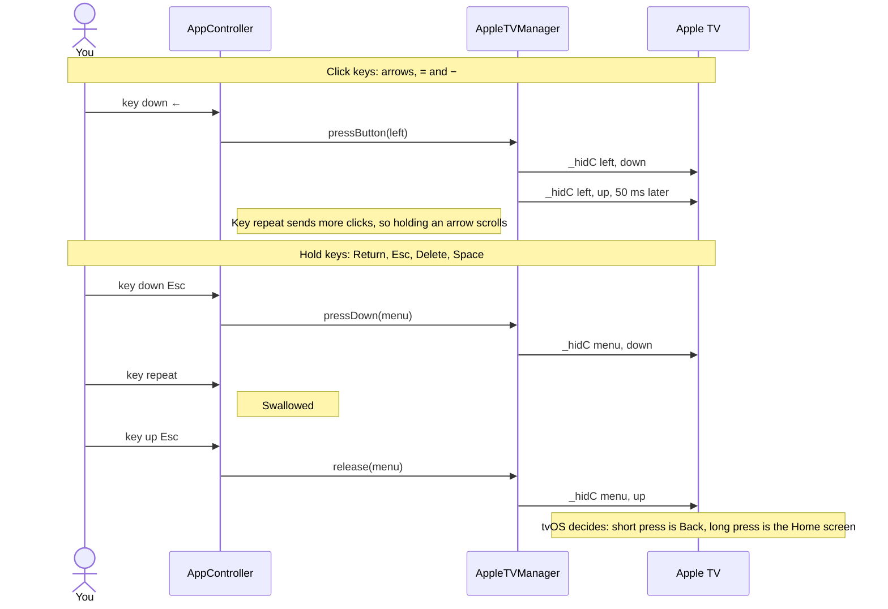
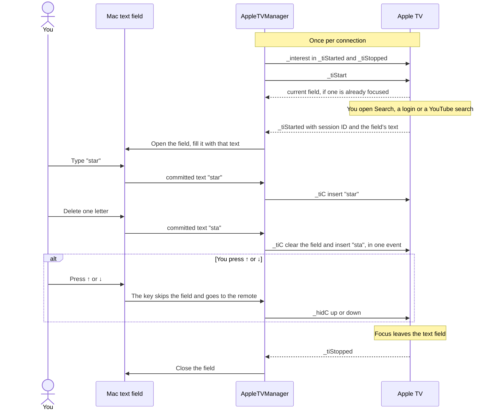
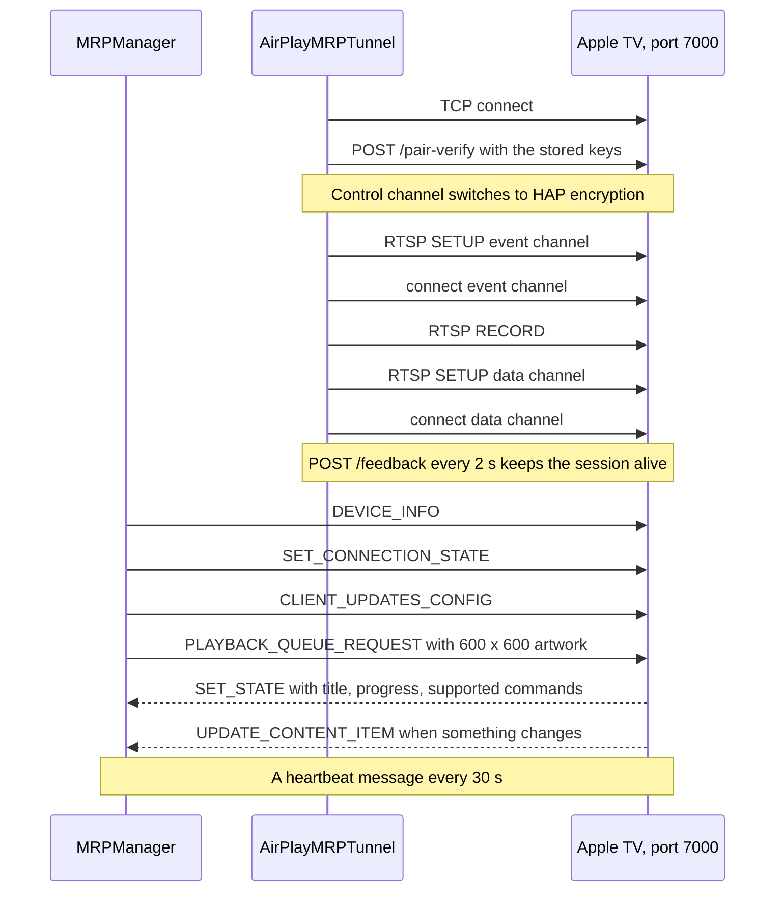
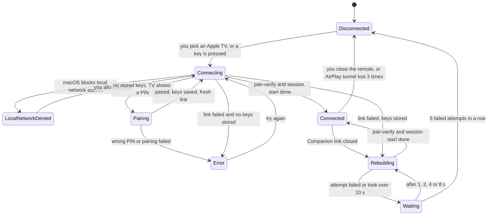

# How TV Remote for Mac works

This is the long version of [How it works](../README.md#how-it-works) in the README. Everything here is taken from the code; file names point to where each part lives. The protocol layer is the Swift package `ItsytvCore`, which comes from [Itsytv](https://github.com/nickustinov/itsytv-macos); much of what it knows about the Apple TV was first documented by [pyatv](https://github.com/postlund/pyatv).

**Contents**

1. [The big picture](#1-the-big-picture)
2. [Finding the Apple TV](#2-finding-the-apple-tv)
3. [Pairing and connecting](#3-pairing-and-connecting)
4. [What goes over the wire](#4-what-goes-over-the-wire)
5. [Pressing a key](#5-pressing-a-key)
6. [Typing on the Apple TV](#6-typing-on-the-apple-tv)
7. [Now playing over the AirPlay tunnel](#7-now-playing-over-the-airplay-tunnel)
8. [Staying connected](#8-staying-connected)
9. [Message reference](#9-message-reference)
10. [Code map](#10-code-map)

## 1. The big picture

The Mac app is a thin UI on top of one object, `AppleTVManager`, which owns the connection and all state the UI shows. It talks to two services on the Apple TV: **Companion Link** for remote-control input, and **MediaRemote (MRP)** carried inside an **AirPlay** session for what's playing.



Two rules shape the code:

- **All manager state lives on the main thread.** Network callbacks arrive on background queues; `AppleTVManager.attach` hops every one of them to the main thread and drops callbacks from a link that has already been replaced, so a late "disconnected" from an old link can't tear down a new one.
- **Commands never go out on a half-ready link.** If the link isn't verified yet, a key press is queued and sent once the session is up (see [Staying connected](#8-staying-connected)).

## 2. Finding the Apple TV

`DeviceDiscovery` browses Bonjour for `_companion-link._tcp` services and reads each one's TXT record.

| Step | What the code does |
|---|---|
| Filter | Keeps only services whose `rpFl` flags include `0x4000`. HomePods, Macs and iPads advertise the same service without that flag. |
| Identify | Uses the Bonjour service name as the device ID (`rpBA` rotates for privacy). Pairing keys in the Keychain are stored under this ID. |
| Keep looking | Restarts the browser every 5 seconds to catch devices that were asleep or whose mDNS packets got lost. |
| Wake a sleeping TV | On refresh, opens a TCP connection to the last device on ports 3689, 7000, 49152 and 49153; a sleeping Apple TV then re-advertises its services. |
| Stop | Pauses browsing once a session is connected. |

## 3. Pairing and connecting

`CompanionConnection` opens TCP (`NWConnection`) straight to the Bonjour service, then one of two things happens.

- **No keys in the Keychain:** pair-setup. This is the only time you see a PIN.
- **Keys found:** pair-verify. Both sides prove they hold the keys from pairing and derive fresh session keys.



Details worth knowing:

- **Why a fresh connection after pairing.** A comment in `AppleTVManager` notes that tvOS 27 ignores pair-verify on the connection used for pair-setup and only closes it about 30 seconds later, so the app verifies on a new connection, as pyatv does.
- **Why `TVRCSessionStart`.** On tvOS 26.5 and later the TV silently drops the app-list request unless a TV-remote session is registered first. Older tvOS may not answer, so the app also moves on after 2 seconds.
- **Apple TV reset or replaced.** If pair-verify finds a different identity than the one stored, the app deletes the stale keys and starts pairing again by itself.
- **Local network access denied.** If macOS blocks local network access, the status says so and the connection keeps waiting; it continues on its own once you allow access.

## 4. What goes over the wire

Every Companion Link message is a frame:

```text
+----------+----------------------+--------------------------------------+
| type     | length               | payload                              |
| 1 byte   | 3 bytes, big-endian  | OPACK dictionary                     |
|          |                      | encrypted payload + 16-byte tag      |
+----------+----------------------+--------------------------------------+
```

- **OPACK** is Apple's compact binary encoding of dictionaries. Each message has `_t` (1 event, 2 request, 3 response), `_i` (the message name, such as `_hidC`), `_c` (content) and, for requests, `_x` (an ID that the response echoes back).
- **Encryption.** After pair-verify each direction has its own ChaCha20-Poly1305 key and its own nonce counter, starting at 0 and growing by one per frame. The 4-byte header is authenticated as additional data.
- **Why there's one lock.** Commands are sent from the main thread, from timers (button release, swipes) and from the 30-second keep-alive at the same time. If two frames were encrypted in one order and written in another, the Apple TV's nonce counter would be off and it would drop the link. `CompanionConnection` encrypts and hands the frame to the network inside one critical section, so nonce order always equals wire order.
- **One disconnect report.** A dropped link shows up both as a receive error and as a failed state; the connection reports it to the manager only once.

## 5. Pressing a key

Keys are caught by a local `NSEvent` monitor on the remote panel (`AppController`) and looked up in the `RemoteShortcut` table, which you can change in the Keyboard shortcuts window. A button is sent as `_hidC` with `_hBtS` 1 (down) and 2 (up).



- Because the button really stays down for as long as you hold the key, tvOS itself tells a click from a hold, exactly as with a Siri Remote. Hold Return for the context menu, Esc for the Home screen, Delete for Control Center.
- A held button is released after at most 8 seconds, or when the panel loses focus, so a lost key-up can't leave a button stuck down on the TV.
- Shortcuts with ⌘ (⌘K, ⌘F, ⌘W, ⇧⌘M) work even while the text field has focus; plain keys go to the field, except ↑ and ↓ (see below).
- Mute is not a Companion button: it goes over MediaRemote as a HID consumer-page mute key.

## 6. Typing on the Apple TV

The Apple TV tells subscribers when one of its text fields gets or loses focus, the same signal the iPhone remote uses to pop up its keyboard. Text travels in `_tiD` payloads: binary property lists in the format of `RTIKeyedArchiver`, Apple's private text-input classes, which `TextInputSession` builds and reads by hand.



How each piece works:

| Piece | Behaviour |
|---|---|
| Text already on the TV | `_tiStarted` carries the field's state. The app joins the text before the cursor, the selection and the text after it (`contextBeforeInput`, `selectedText`, `contextAfterInput`) and shows it in the Mac field with the cursor at the end. |
| Typing forward | If the new text starts with what was already sent, only the new characters go out as an insert. |
| Deleting or editing | Otherwise the app sends one event that clears the field and inserts the whole new text, so the TV never flashes an empty field. |
| Input methods | `ComposeAwareTextField` reports only committed text. Characters still being composed (Japanese, Chinese, Korean) are held back until you confirm them. |
| A new field on the TV | Each focused field gets a new session ID; the app always types into the latest one. |
| Opening the field by hand (⌘K) | The app restarts the text session (`_tiStop`, then `_tiStart`) to read the current field. The `_tiStopped` that its own restart may cause is ignored for 1.5 s, so the field doesn't close itself. |
| Leaving with ↑ / ↓ | While a TV field is focused, real ↑ and ↓ keys skip the one-line Mac field and move focus on the TV, which then sends `_tiStopped`. |

## 7. Now playing over the AirPlay tunnel

Now-playing data comes from MediaRemote (MRP), Apple's protobuf protocol, which the app reaches through an AirPlay 2 session on port 7000 of the same Apple TV. It reuses the keys from Companion pairing.



The remote's previous and next track buttons, seeking, AppleScript `play` and `pause`, and mute go over this tunnel. Everything else (d-pad, Select, Back, TV, Play/Pause button, volume buttons, apps, typing) goes over Companion Link. If the tunnel drops, the app retries it up to 3 times, a second apart; after that it disconnects.

## 8. Staying connected

The Apple TV closes the Companion Link from time to time, which is routine, and Wi-Fi drops happen. What the user sees as "connected" stays connected while the app quietly rebuilds the link underneath.



The rules, all in `AppleTVManager`:

| Rule | Value |
|---|---|
| First retry after a drop | immediately |
| Later retries | 1 s, 2 s, 4 s, then 8 s |
| Time limit per attempt | 10 s (an unreachable TV could otherwise keep the link waiting forever) |
| Give up after | 5 failed attempts in a row, then disconnect |
| Retry counter resets | when pair-verify succeeds |
| Status shown during a rebuild | stays "connected" (now playing still works over AirPlay) |
| Key presses during a rebuild | queued, sent in order once the new link is verified and the session started |
| Key presses while fully disconnected | queued, and the app reconnects to the last Apple TV on its own |

Here, "Rebuilding" and "Waiting" are internal: the status the UI shows is still `connected` (or `connecting` on the very first try), but `isCompanionReady` is false, so commands wait in the queue. A link is "ready" only when the status is connected, a link exists and no rebuild is running.

## 9. Message reference

**Companion Link frames**

| Frame | Purpose |
|---|---|
| pair-setup start / next | First pairing, M1 to M6 |
| pair-verify start / next | Every connection, M1 to M4 |
| encrypted OPACK | Every message after pair-verify |
| NoOp | Keep-alive every 30 s |

**Companion Link messages**

| Message | Kind | Direction | Purpose |
|---|---|---|---|
| `_systemInfo` | request | Mac → TV | Introduce the client; the reply's `_osV` is the tvOS version |
| `_sessionStart` | request | Mac → TV | Start a `com.apple.tvremoteservices` session |
| `_touchStart` | request | Mac → TV | Open a 1000 × 1000 virtual touchpad |
| `_interest` | event | Mac → TV | Subscribe to `_tiStarted` and `_tiStopped` |
| `TVRCSessionStart` | request | Mac → TV | Register a TV remote session (needed for the app list on tvOS 26.5+) |
| `FetchLaunchableApplicationsEvent` | request | Mac → TV | List installed apps (bundle ID and name) |
| `_launchApp` | request | Mac → TV | Open an app by bundle ID |
| `_hidC` | request | Mac → TV | Button down (`_hBtS` 1) or up (`_hBtS` 2) |
| `_hidT` | event | Mac → TV | Touch at x, y with phase press, hold or release (swipes, touchpad) |
| `_tiStart` | request | Mac → TV | Get the focused text field: session ID and current text |
| `_tiStop` | request | Mac → TV | End the current text session |
| `_tiC` | event | Mac → TV | Insert text, or clear and insert, in a text session |
| `_tiStarted` | event | TV → Mac | A text field got focus; carries session ID and text |
| `_tiStopped` | event | TV → Mac | The text field lost focus |

**MediaRemote messages (inside the AirPlay tunnel)**

| Message | Direction | Purpose |
|---|---|---|
| `DEVICE_INFO`, `SET_CONNECTION_STATE` | Mac → TV | Introduce the client |
| `CLIENT_UPDATES_CONFIG` | Mac → TV | Ask for now playing, artwork, volume, keyboard and output device updates |
| `PLAYBACK_QUEUE_REQUEST` | Mac → TV | Fetch the current item with 600 × 600 artwork |
| `SET_STATE`, `UPDATE_CONTENT_ITEM` | TV → Mac | Title, progress, artwork, supported commands |
| `SEND_COMMAND` | Mac → TV | Play, pause, previous, next, skip, seek |
| `SEND_HID_EVENT` | Mac → TV | Mute key, followed by a generic message to reset protocol state |
| `GENERIC_MESSAGE` | Mac → TV | Heartbeat every 30 s |

## 10. Code map

| Path | What's there |
|---|---|
| `itsytv/UI/AppController.swift` | Status item, floating panel, local key monitor, key holds, PIN pad |
| `itsytv/UI/MenuBarView.swift` | Remote UI; opens and closes the text field when the TV says so |
| `itsytv/UI/ComposeAwareTextField.swift` | Text field that understands input methods; cursor at the end |
| `itsytv/Shortcuts/RemoteShortcut.swift` | Default keys, which keys hold, custom keys in UserDefaults |
| `itsytv/Utilities/` | Global hotkeys, AppleScript commands, update check |
| `ItsytvCore/.../Protocol/AppleTVManager.swift` | Connection lifecycle, command queue, reconnects, text input |
| `ItsytvCore/.../Protocol/CompanionConnection.swift` | TCP link, frame parsing, encryption, request and response matching |
| `ItsytvCore/.../Protocol/CompanionCommands.swift` | `_hidC`, `_hidT`, `_launchApp`, `_tiC`, `_interest` and friends |
| `ItsytvCore/.../Protocol/TextInputSession.swift` | `RTIKeyedArchiver` payloads for typing |
| `ItsytvCore/.../Crypto/` | Pair-setup (SRP), pair-verify, ChaCha20-Poly1305, Keychain storage |
| `ItsytvCore/.../Discovery/` | Bonjour discovery and waking a sleeping Apple TV |
| `ItsytvCore/.../AirPlay/` | AirPlay 2 session that carries MediaRemote |
| `ItsytvCore/.../MRP/` | MediaRemote messages: now playing, artwork, media commands |
